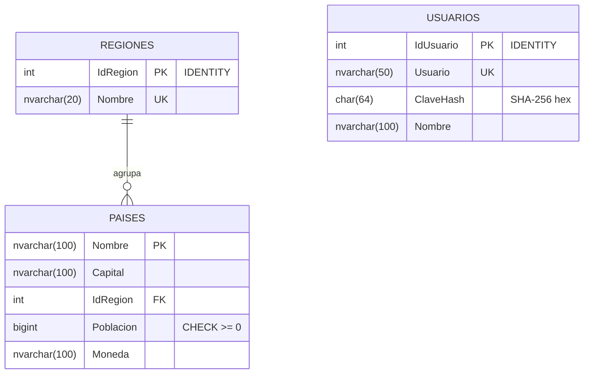

# Modelo entidad-relación: APIPaisesDB (SQL Server)

Especificación para dibujar el MER (CDM/LDM/PDM) en PowerDesigner. Coincide con la migración `InitialCreate` de Entity Framework Core (`04. SERVIDOR/WS_APIPAISES_DOTNET_REST/Data/AppDbContext.cs`) y con el script generado `03. BDD/APIPaisesDB.sql`.

| Entidad | Atributo | Tipo | Restricciones | Origen del dato |
|---|---|---|---|---|
| Regiones | IdRegion | int | PK, `IDENTITY` | — |
| | Nombre | nvarchar(20) | único (`AK_REGIONES_NOMBRE`), no nulo | Catálogo fijo: América, Europa, Asia, África, Oceanía, Antártida |
| Paises | Nombre | nvarchar(100) | PK (`PK_PAISES`) | `names.translations.spa.common`, o `names.common` si no hay traducción |
| | Capital | nvarchar(100) | no nulo | Capital principal, o «Sin capital» |
| | IdRegion | int | FK → Regiones (`FK_PAISES_REGIONES`), no nulo, índice `IX_PAISES_REGION` | `region` traducida al español |
| | Poblacion | bigint | no nulo, `CK_PAISES_POBLACION` ≥ 0, índice `IX_PAISES_POBLACION` | `population` |
| | Moneda | nvarchar(100) | no nulo | Primera moneda como «nombre (código)», o «Sin moneda» |
| Usuarios | IdUsuario | int | PK, `IDENTITY` | — |
| | Usuario | nvarchar(50) | único (`AK_USUARIOS_USUARIO`), no nulo | Datos semilla de la migración |
| | ClaveHash | char(64) | no nulo | SHA-256 de la clave en hexadecimal |
| | Nombre | nvarchar(100) | no nulo | Nombre visible en los clientes |

Las columnas de texto usan la collation `Latin1_General_100_CI_AI`: no distinguen mayúsculas ni tildes. Así «quito» encuentra «Quito» y «Perú» y «peru» son el mismo país (clave primaria).

Relaciones:
- **Regiones 1 — 0..N Paises** (`FK_PAISES_REGIONES`, `ON DELETE NO ACTION`): no se puede borrar una región que tenga países.
- **Usuarios** es independiente: solo sirve para autenticar (ECUD1).

Datos iniciales (en la migración, con `HasData`): las seis regiones y los usuarios `admin`/`admin123` (Administrador) y `msosa`/`msosa` (Mateo Sosa).
